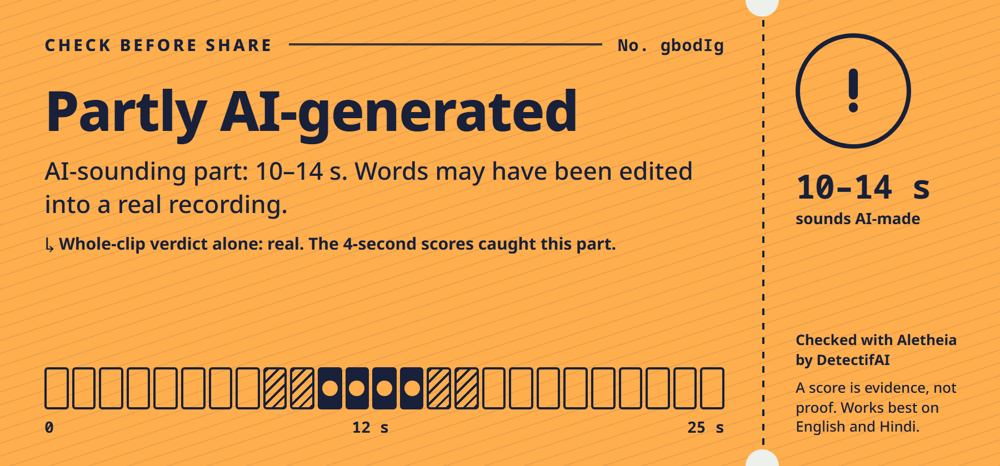
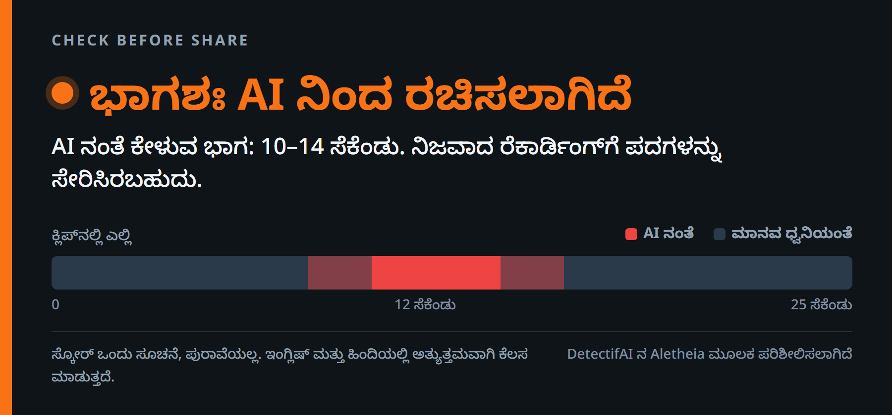

# Check Before Share

**A Telegram group guardian that checks forwarded voice notes and videos for AI-generated voices,
shows *which seconds* sound fake, and replies in Kannada, Hindi or English with a card people can
forward instead of the fake.**

Built for the CMRIT × DetectifAI hackathon, Track 4 (*Verify the Viral*), on
**DetectifAI's Aletheia** deepfake-voice model.

<p>
  
  
</p>

> **Draft (Lane B, step B5).** Parts marked *(Sync 2)* are being built by Lane A and will be
> confirmed before submission. Setup for teammates is at the bottom.

---

## The problem

Every family and college WhatsApp group has seen it: a voice note that "the principal" or "the
apartment association" sent, announcing a holiday, a fine or an urgent payment. These used to be
easy to spot. Now a voice can be cloned from 10 seconds of audio, and the sneakiest fakes aren't
fully fake at all: they're a **real recording with one sentence swapped in** ("…and everyone must
send ₹500 to this number by tonight").

People forward these because they *sound* right, and the people who'd check them (a younger
cousin, a class rep) can't run a deepfake detector from a group chat.

## What it does

1. **Add the bot to a group** (or forward it a clip in a private chat). It checks every voice note,
   audio file, video and round video message, up to Telegram's 20 MB limit for bots.
2. **It replies with a verdict** in the group's language (`/lang en | hi | kn`, English by default):

   | Band | When | What people see |
   |---|---|---|
   | 🔴 **Likely AI-generated** | Aletheia's overall verdict is *fake* | "Don't forward it. Check the official source first." |
   | 🟠 **Partly AI-generated** | overall *real*, but **2+ overlapping 4-second windows** are fake | "AI-sounding part: 10–14 s. Words may have been edited into a real recording." |
   | 🟡 **Unclear** | one isolated fake window, or less than 10 s of speech | "Too short or mixed to tell. Ask the sender where it came from." |
   | 🟢 **No signs** | everything real | "This checks the voice, not whether the claim is true." |

3. **A verdict card** (image above) with a timeline of the clip, so the answer can be forwarded
   back into the same groups the fake went to.
4. **Group etiquette:** a clean 🟢 result in a group gets one quiet line, not a full card.
5. **"Was this right? 👍 / 👎"** under every verdict. Answers go back to DetectifAI through its
   feedback API, so the model learns from Kannada and Hindi voice notes it might not see otherwise.
6. *(Sync 2)* **"Already checked N times":** the same clip forwarded again is recognised (even
   after WhatsApp re-compresses it) and answered from the cache for 0 credits.
7. *(Sync 2)* **A timeline page** for each check: the waveform with the fake part in red; click it
   to hear exactly the suspicious sentence.
8. *(Sync 2)* **Android share sheet:** WhatsApp → Share → *Check Before Share*, for people who
   don't use Telegram.

## How we use Aletheia, and why the timeline matters

**One REST call per clip** (`POST /v1/deepfake/detect`). The response already contains scores for
overlapping **4-second windows every 2 seconds**, so we never cut the audio up ourselves (that would
cost about 5× the credits).

What we found while testing: **the overall verdict alone misses spliced fakes.** We made a real
recording with one AI sentence pasted in at 10.0–14.8 s:

| Clip | Overall verdict | 4-second windows |
|---|---|---|
| Real speech + 1 AI sentence | ❌ **real** (score 0.28) | ✅ 8–16 s flagged fake (0.98–1.00) |
| Same clip, WhatsApp-quality (Opus 16 kb/s) | ❌ **real** (0.25) | ✅ still flagged |

So our verdict reads the windows, not just the headline: seconds covered by **two or more**
overlapping fake windows form the "core region". That rule placed the fake at **10–14 s**
against the true 10.0–14.8 s; flagging any single fake window gave a sloppier 8–16 s.

Also used:
- **Feedback API** (`POST /v1/operations/{id}/feedback`) for users' 👍/👎.
- **Idempotency keys** (hash of the normalised audio), so retries cost nothing.
- **The DetectifAI MCP server** inside Claude Code while building, to explore results quickly.
  The product itself uses the REST API: it's faster, has no AI model in the loop, and accepts
  100 MB files instead of 25 MB.

## How well does it work? (our own tests)

**Real voices: 0 false alarms in 12 checks.** Our own voice notes (English, Hindi, Kannada),
recorded on a phone, each checked clean and as a WhatsApp-quality copy:

| Language | Clips | Called real | Highest 4-s window score |
|---|---|---|---|
| English | 2 (×2 versions) | 4 / 4 | 0.02 – 0.17 |
| Kannada | 2 (×2) | 4 / 4 | 0.12 – 0.26 |
| Hindi | 2 (×2) | 4 / 4 | 0.63 – 0.88 (closest to a false alarm) |

**Synthetic voices** (generic text-to-speech in English, Hindi and Kannada): all caught, score ≥ 0.999.

**Cloned voices of a real person: 6 / 6 caught.** We cloned our own voice (with consent) from about
10 seconds of audio, using free open-source models a scammer could run on a gaming laptop:
Chatterbox for English, IndicF5 for Hindi and Kannada. Every clone was called fake, clean and
WhatsApp-quality (scores 0.94–1.00).

**The dangerous case — a real voice note with one cloned sentence pasted in: 6 / 6 flagged.**

| Language | Fake sentence really at | Aletheia's overall verdict | What we reply |
|---|---|---|---|
| English | 10.1–13.8 s | ❌ real | 🟠 partly AI-generated, **10–14 s** |
| Kannada | 13.0–18.0 s | ❌ real | 🟠 partly AI-generated, **14–16 s** |
| Hindi | 18.0–24.5 s | ✅ fake | 🔴 likely AI-generated |

For English and Kannada the overall verdict alone would have let the fake through; reading the
4-second windows is what caught it, and our rule placed it inside the true seconds (same result on
the WhatsApp-quality copies).

Full tables and raw notes: [`research/real-world.md`](research/real-world.md),
[`PLAN.md`](PLAN.md) §1.

## Honest limits

- **A score is evidence, not proof.** We say so on every card.
- **It checks the voice, not the claim.** A real person can still say something false.
- **Small test set:** 6 real recordings, 3 clones and 3 spliced clips, male voices only, one
  phone, a quiet room. No women's voices yet.
- **Where, not just whether, is approximate:** for the Kannada splice we pointed at 14–16 s of a
  13.0–18.0 s fake; for the Hindi splice the model called the whole clip fake, so we lose the
  "which seconds" detail there.
- **WhatsApp compression was simulated** with ffmpeg, not taken from WhatsApp itself.
- **Hindi runs "hotter"** than English and Kannada on real voices (one window scored 0.88 and was
  still labelled real by the model). Aletheia's docs say it works best on English and Hindi.
- **Sped-up or slowed-down copies:** between 0.75× and 1.75× the fake part was still found in the
  right place; at 0.5× the whole clip was called fake, and at 2× the fake part was too short to
  flag. Once the original has been checked, such a copy is recognised and gets the original's
  result for free (tested offline: speed copies ≥ 0.84, pitch copies ≥ 0.86, different clips
  ≤ 0.67). Not recognised: a copy that is both pitch-changed and trimmed, or changed beyond
  0.5–2× / ±6 semitones. See `research/speed-test.md`.
- **Short clips are unreliable:** under 10 seconds of speech we say 🟡 Unclear rather than guess.
- **Limits:** Telegram bots can download up to 20 MB; Aletheia checks up to 5 minutes (we check
  the first 5 and say so).

## Privacy and consent

- The bot downloads a clip to a temporary folder, checks it and deletes it straight away.
- Every cloned voice in our tests is **our own**, cloned with consent, for testing only. We never
  clone public figures.
- API keys and the bot token live only in `.env`, which is never committed.

## Architecture

```
 Telegram group/DM ──► bot.py ─┐                         ┌─► cache hit? (Telegram file id, same bytes, same decoded audio, audio fingerprint, speed/pitch copy)
                               ├─► core.check(audio) ────┤        └─► yes: stored result, "checked N times", 0 credits
 Android share sheet ─► api.py ┘   (normalise with ffmpeg └─► no: POST /v1/deepfake/detect
   (PWA share target)               mono 16 kHz, ≤ 300 s)           └─► verdict bands + core regions → SQLite
                                                           ▼
     reply in en/hi/kn + verdict card (HTML → PNG with Playwright) + link to /r/<id> timeline page
```

Python 3.11 · python-telegram-bot · FastAPI · Playwright/Chromium (cards, so Kannada and Hindi
text shapes correctly) · ffmpeg · Chromaprint · SQLite · wavesurfer.js.

---

## Run it yourself

```bash
git clone <repo-url> && cd <repo>
python -m venv .venv
# Windows: .venv\Scripts\activate    macOS/Linux: source .venv/bin/activate
pip install -r requirements.txt
playwright install chromium
cp env.example .env          # then fill in your keys (never commit .env)
python -m pytest -q
```

```bash
python -m scripts.credits          # check your DetectifAI API key + credit balance
python -m app.bot                  # the Telegram bot
uvicorn app.api:app --port 8000    # web server: result pages + share target (Sync 2)
```

With `MOCK_ALETHEIA=cycle` in `.env`, everything runs on recorded real Aletheia results and uses no
credits (replies are marked "Test mode").

**Telegram setup:** create the bot with @BotFather, then `/setprivacy` → **Disable** so it can see
voice notes in groups, and **remove and re-add** it to any group it was already in.

Chromaprint `fpcalc` (for the "already checked" cache): on Windows, download 1.5.1 from
https://github.com/acoustid/chromaprint/releases and put `fpcalc.exe` in `bin/`; on Fedora,
`sudo dnf install chromaprint-tools` (it's then found on PATH). The bot's startup log and `/health`
say loudly if it's missing.

**How a repeat clip is recognised (0 credits), cheapest first:** the same Telegram file id → the
same bytes → the same decoded audio (catches another container or lossless format, a renamed or
re-tagged file, a voice note inside a video; works without `fpcalc`) → an audio fingerprint
(Chromaprint ≥ 0.80, catches lossy re-encodes like WhatsApp Opus, MP3 and AAC) → a copy at
another speed or pitch (0.5–2× with the pitch kept or changed with it, or the voice made higher or
deeper at the same length: the change is undone with ffmpeg and the clip fingerprinted again;
about 1 s, only when everything before it missed). Only then is Aletheia called.

## Team and how we built it

A team of two, each working with Claude Code in a separate lane, joined by one interface
([`CONTRACT.md`](CONTRACT.md)): **Lane A** built the engine and web (normalising, Aletheia client,
verdict rules, cache, result page, share target); **Lane B** built the bot, the card, the
three-language wording and this write-up. Plan and evidence: [`PLAN.md`](PLAN.md), [`research/`](research/).
